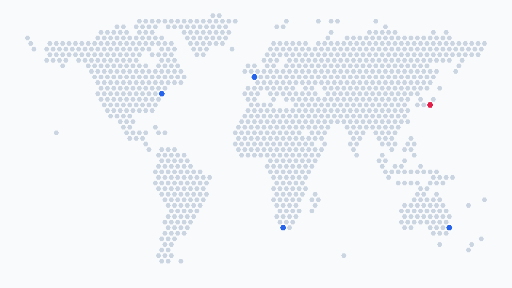

# World Hex Map

A lightweight, offline world hex map for Flutter/Dart and TypeScript. Both
packages use the same generated land grid and expose matching coordinate and
cell utilities. Flutter includes a customizable widget, while TypeScript
includes a dependency-free SVG renderer for browsers, server-side rendering,
and static files.



> **Release status:** Version 0.2.0 is prepared but has not yet been published
> to pub.dev or npm. The registry commands below become available with the
> first public release; until then, use a local checkout for evaluation.

## Features

- Recognizable 72 × 47 world silhouette with 1,141 land cells
- Offline rendering with no tile server, API key, map SDK, or runtime fetch
- Latitude and longitude snapping to the nearest land cell
- Flutter widget with colors, markers, spacing, semantics, and tap handling
- TypeScript SVG rendering with colors, coordinate markers, and accessibility
- Reproducible generator that emits Dart and TypeScript from one pinned source

## Compatibility

| Package | Minimum | Module/runtime format |
| --- | --- | --- |
| Flutter/Dart | Dart 3.0, Flutter 3.10 | Flutter package |
| TypeScript | ES2020, Node.js 18 | Typed ES modules |

## Flutter and Dart

### Installation

After the first registry release, install the Flutter package with:

```sh
flutter pub add world_hex_map
```

To depend on a specific GitHub release instead, pin its tag:

```yaml
dependencies:
  world_hex_map:
    git:
      url: https://github.com/kong75/world-hex-map.git
      ref: v0.2.0
```

### Usage

```dart
import 'package:flutter/material.dart';
import 'package:world_hex_map/world_hex_map.dart';

WorldHexMap(
  landColor: const Color(0xFFD0D5DD),
  markerColor: const Color(0xFF2563EB),
  markers: <WorldHexMarker>[
    WorldHexMarker.fromCoordinates(
      latitude: 40.7128,
      longitude: -74.0060,
    ),
    WorldHexMarker.fromCoordinates(
      latitude: 35.6762,
      longitude: 139.6503,
    ),
  ],
  onCellTap: (cellId) {
    final center = WorldHexGrid.geographicCenter(cellId);
    debugPrint('${center.latitude}, ${center.longitude}');
  },
)
```

To use the grid without rendering the widget:

```dart
final cellId = WorldHexGrid.nearestLandCell(
  latitude: 51.5072,
  longitude: -0.1276,
);

final normalizedCenter = WorldHexGrid.normalizedCenter(cellId);
```

See [`example/lib/main.dart`](example/lib/main.dart) for a complete app.

## TypeScript

### Installation

After the first registry release, install the npm package with:

```sh
npm install world-hex-map
```

For a pinned GitHub release, use:

```sh
npm install github:kong75/world-hex-map#v0.2.0
```

The package ships as typed ES modules for Node.js and modern browsers. It has
no runtime dependencies.

### Grid usage

```ts
import {WorldHexGrid} from 'world-hex-map';

const cellId = WorldHexGrid.nearestLandCell({
  latitude: 51.5072,
  longitude: -0.1276,
});

const normalizedCenter = WorldHexGrid.normalizedCenter(cellId);
const geographicCenter = WorldHexGrid.geographicCenter(cellId);
```

### SVG rendering

```ts
import {renderWorldHexMap} from 'world-hex-map';

const svg = renderWorldHexMap({
  ariaLabel: 'Locations around the world',
  landColor: '#d0d5dd',
  markerColor: '#2563eb',
  markers: [
    {latitude: 40.7128, longitude: -74.006},
    {latitude: 35.6762, longitude: 139.6503, color: '#e11d48'},
  ],
});

document.querySelector('#map')!.innerHTML = svg;
```

`renderWorldHexMap` returns standalone SVG markup, so the same result can be
used with an SSR framework or written to an `.svg` file without a DOM.

The renderer accepts these commonly used options:

| Option | Purpose | Default |
| --- | --- | --- |
| `width`, `height` | SVG dimensions and view box | `720`, `width / 1.78` |
| `landColor`, `backgroundColor` | Base map colors | `#d0d5dd`, transparent |
| `markers` | Cell IDs or latitude/longitude markers | `[]` |
| `markerColor`, `markerBorderColor` | Marker defaults | Blue, white |
| `cellScale`, `padding` | Cell spacing and map inset | `0.78`, `0` |
| `ariaLabel`, `className` | Accessibility and CSS hooks | `World hex map`, none |

Run the checked-in TypeScript example to produce a standalone SVG:

```sh
npm ci
npm run example:typescript
```

The result is written to `build/typescript-example/world-hex-map.svg`. See
[`examples/typescript/render-map.ts`](examples/typescript/render-map.ts) for
the complete source.

## API at a glance

Both languages provide the same grid operations through `WorldHexGrid`:

| API | Result |
| --- | --- |
| `cellId`, `rowOf`, `columnOf` | Convert between cell IDs and grid indexes |
| `normalizedCenter` | Center from 0 to 1 for rendering |
| `geographicCenter` | Approximate latitude and longitude of a cell |
| `nearestLandCell` | Closest visual land cell for a coordinate |
| `isLandCell`, `landCellIds` | Inspect the generated land silhouette |

Invalid coordinates and cell indexes throw `RangeError` in both languages.
See [`ARCHITECTURE.md`](ARCHITECTURE.md) for the generation flow and
cross-language compatibility contract.

## How the grid is generated

The generator samples pinned Natural Earth 1:10m land polygons against a
staggered hex grid. Area-aware supersampling keeps the coastline recognizable,
while a second pass preserves representative cells for islands that would
otherwise disappear at this resolution.

Regenerate the checked-in Dart and TypeScript data with Node.js and the Dart
SDK available:

```sh
node tool/generate_world_hex_grid.mjs
```

Both generated files are committed so applications never need network access
at runtime and both language implementations stay on the same cell IDs.

The deterministic preview above is rendered from the real Flutter widget at
1440 × 810. Regenerate and verify it with:

```sh
flutter test --update-goldens tool/world_hex_map_preview_test.dart
flutter test tool/world_hex_map_preview_test.dart
```

## Scope and accuracy

World Hex Map is a compact visualization, not a GIS index, navigation system,
or authoritative boundary dataset. Coordinates are snapped to the nearest
visual land cell. Antarctica is intentionally outside the map's displayed
latitude range.

## Data source

The generator uses [Natural Earth](https://www.naturalearthdata.com/) 1:10m
land polygons. Natural Earth data is public domain. See
[`THIRD_PARTY_NOTICES.md`](THIRD_PARTY_NOTICES.md) for the pinned revision and
source details.

## Contributing

Issues and pull requests are welcome. Read [`CONTRIBUTING.md`](CONTRIBUTING.md)
before submitting a change.

This project follows semantic versioning. While the project remains on a 0.x
release, minor versions may refine public APIs; changes are documented in
[`CHANGELOG.md`](CHANGELOG.md). Security fixes target the latest release.

## License

World Hex Map is available under the [MIT License](LICENSE).
